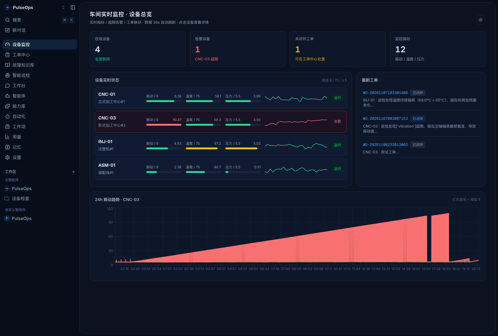
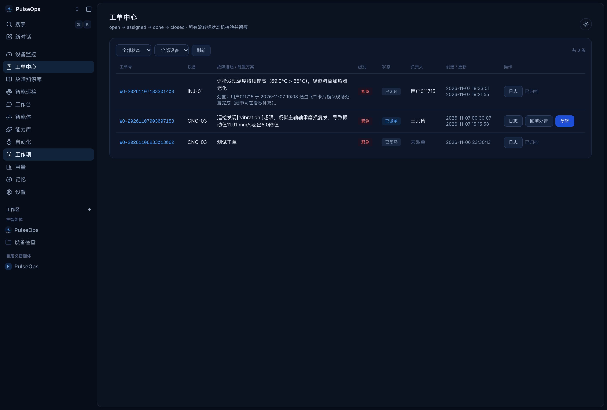
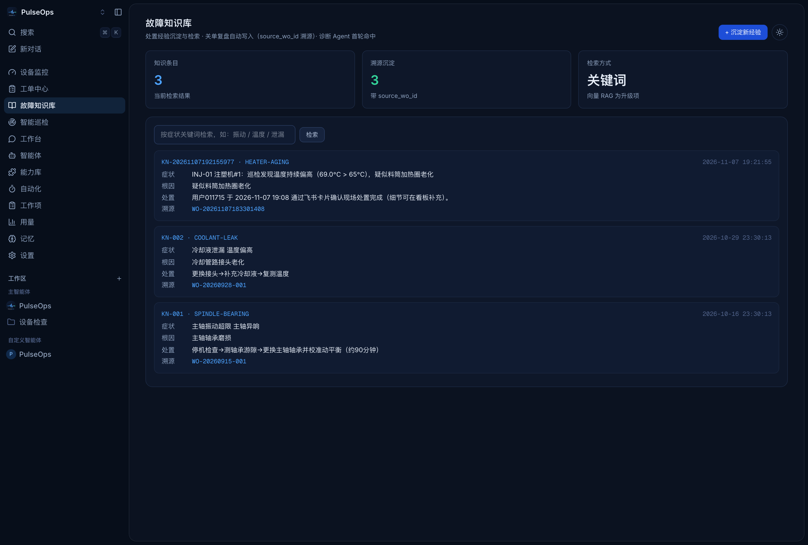
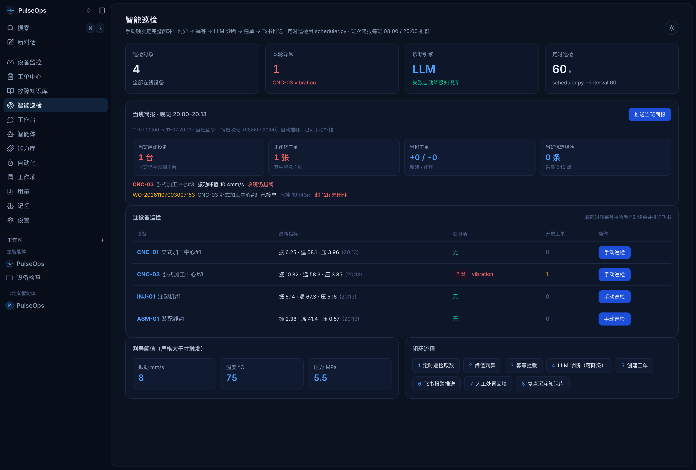
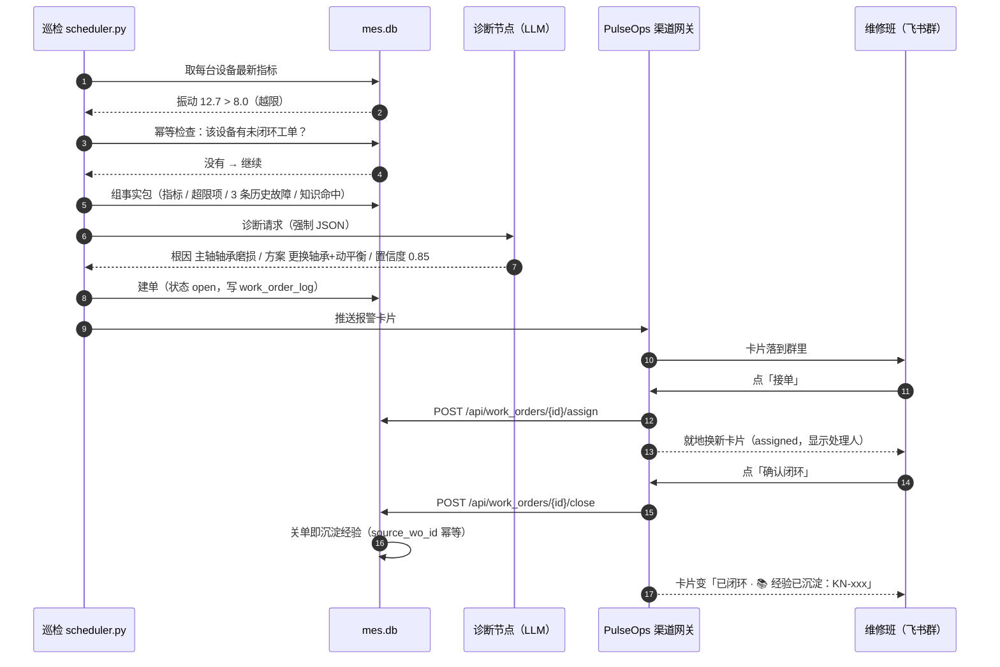
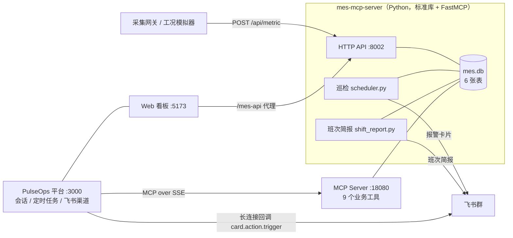

<p align="center">
  
</p>

<h1 align="center">PulseOps · 脉巡</h1>

<p align="center">
  <strong>设备异常工单闭环 Agent</strong><br/>
  巡检发现异常 → LLM 诊断根因 → 幂等建单 → 飞书推报警 → 群里点按钮处置 → 关单自动沉淀经验
</p>

<p align="center">
  
  
  
  
  
  
  
</p>

---

## 目录

[这是什么](#这是什么) · [界面](#界面) · [闭环流程](#闭环流程) · [技术点](#技术点) · [架构](#架构) · [数据模型](#数据模型) · [跑起来](#跑起来) · [测试](#测试与验收) · [边界](#边界与取舍) · [目录结构](#目录结构) · [致谢](#上游与致谢) · [License](#license)

## 这是什么

一条产线 4 台设备，值班的是班组长和 2 个维修工。**没人盯得住 24 小时的曲线**——所以异常通常是在「已经停机之后」才被发现，工单靠口头传，处置结果留在师傅脑子里。

PulseOps 把这段流程做成闭环，扮演三个角色：

| 角色 | 谁来干 | 干什么 |
| --- | --- | --- |
| **巡检** | 确定性代码（Cron） | 定时取最新指标比阈值，越限就进入诊断，已有未闭环工单就跳过 |
| **诊断** | LLM（可降级） | 把指标 + 超限项 + 历史故障 + 知识命中组装成事实包，输出根因/方案/置信度 |
| **工单** | 确定性代码 | 建单、发飞书卡片、校验状态流转、关单时把这次处置写回知识库 |

它**不是一块只读的大屏**。区别在于：大屏的终点是「看见异常」，这里的终点是「这张单被谁、在什么时候、用什么办法关掉，并且下次同类异常能直接查到」。

## 界面

四个页面共用一套深色工业视觉（右上角可切浅色）。以下截图全部来自**真实运行的 `mes.db`**——拍摄当晚 CNC-03 正处在振动劣化报警中（10.4 mm/s，阈值 8），每张图都是系统正在工作的样子。



**设备监控** —— 一眼分出 4 台设备里谁在告警：

- KPI 行：在线设备 4 · 告警设备 1（CNC-03 走限）· 未闭环工单 1 · 监控指标 12（振动 / 温度 / 压力）
- CNC-03 整行标红：振动 **10.37 mm/s**（阈值 8），其余三台绿色运行
- 底部 24h 振动趋势是这张图的重点：CNC-03 的振动从凌晨起一路爬坡——巡检正是靠这条曲线在停机前把单开出来的
- 右侧「最新工单」实时挂到工单中心，点了就能跳过去处置



**工单中心** —— 3 张真实工单正好对应三种状态：

- CNC-03 那张是「已派单」，负责人王师傅——右侧蓝色的**「闭环」**按钮就是状态机的下一跳
- INJ-01 那张已闭环，处置记录是维修工在飞书卡片上点「已处理 / 确认闭环」回填的
- 每张单都有「日志」入口：状态机每一次流转都留痕（谁、何时、从哪个状态到哪个状态）
- 顶部那行小字 `open → assigned → done → closed · 所有流转经状态机校验并留痕` 就是这套规则的合同



**故障知识库** —— 处置经验的沉淀与检索：

- 最新一条 `KN-2026…`（HEATER-AGING）**不是人工录入的**：它是当晚在飞书卡片上点「确认闭环」时自动沉淀出来的，「溯源」字段直接点回来源工单
- 每条经验固定四段：症状 / 根因 / 处置 / 溯源；KPI「溯源沉淀 3 / 3」表示库里的经验全部可回溯到工单
- 检索按症状关键词命中（搜「振动」「温度」即达），为诊断 Agent 的知识召回预留了升级位



**智能巡检** —— 整个闭环的「驾驶舱」：

- 顶部 KPI：巡检对象 4 · 本轮异常 1（CNC-03 vibration）· 诊断引擎 LLM · 定时巡检 60s
- **当班简报**：晚班 20:00 起当班至今——越阈设备 1 台（CNC-03 振动峰值 10.4 mm/s）、未闭环工单 1 张（已挂 15h43m，超 12h 自动标红）；右上角「推送当班简报」可手动补推到飞书群
- 逐设备巡检：任何一台点「手动巡检」都走完整闭环（判异 → 幂等 → LLM → 建单 → 飞书），和定时巡检共用同一段代码
- 左下角判异阈值（振动 8 mm/s / 温度 75℃ / 压力 5.5 MPa）与右下角 8 步闭环流程，分别是系统的参数表和骨架图

**报警卡片**没有配图——它长在飞书群里，不在浏览器里。一条卡片就是一张工单的随身档案：

| 卡片区块 | 内容 | 来源 |
| --- | --- | --- |
| 头部 | 设备 + 严重度着色（紧急红 / 一般橙） | 工单 severity |
| 指标区 | 超限项与实测值（如「振动 12.7 mm/s > 阈值 8」） | 判异结果 |
| 诊断区 | 根因、处置方案、置信度 | LLM 诊断节点 |
| 操作区 | **接单 → 已处理 → 确认闭环** 三个按钮 | card.action.trigger 回调 |
| 收尾 | 闭环后追加一行「📚 经验已沉淀：KN-xxxx」 | 关单自动沉淀 |

点按钮后卡片**就地重绘**成下一个状态（不是发新卡），全部动作在 3 秒预算内返回——细节见[技术点 ④](#4-飞书卡片回写3-秒预算内的闭环)。

想亲眼看到这张卡片：`make mes-sim` 起模拟器（默认给 CNC-03 注入缓慢劣化，约 9 分钟爬过振动阈值），再等一轮 60s 定时巡检，卡片就会落进群里。

## 闭环流程

一次真实告警从发生到沉淀的完整时序：



三个入口收敛到同一条链路：

- **被动**：定时巡检发现越限（主线）
- **主动**：人在会话里问「3 号机振动不对，看下」→ 问诊解析节点识别设备号与意图 → 进入同一诊断/建单流程
- **汇总**：每班收班（08:00 / 20:00）推一条班次简报，回答「这一班有没有留坑」

## 技术点

### 1. 确定性骨架 + 两个 LLM 节点，而不是「全交给模型」

判断链路里每一环的性质不同，所以分层切得很硬：

| 环节 | 性质 | 实现 |
| --- | --- | --- |
| 定时巡检、阈值判异 | 可穷举 | 普通代码：`v > 8.0` 严格大于，边界值判健康 |
| 未闭环工单去重 | 可穷举 | 普通代码：同设备存在未闭环单则跳过 |
| 工单状态流转 | 可穷举 | 状态机 `open → assigned → done → closed` |
| 根因假设与处置方案 | 不可穷举 | **LLM 诊断节点**：结构化事实包进，强制 JSON 出 |
| 「3 号机振动不对」这类问询 | 不可穷举 | **LLM 问诊解析节点**：自然语言 → 设备号 + 意图 |
| 推送、沉淀、留痕 | 可穷举 | 普通代码：飞书卡片、知识库写入带 `source_wo_id` |

收益很直接：**模型只做判断，不碰写操作**。建单、改状态、推送都由代码执行，模型吐出的每个数字都能在 `mes.db` 里对账；模型挂了、key 失效、返回坏 JSON（重试 1 次后）都会降级为知识库关键词命中，巡检循环不中断。

同一台 CNC-03，两种模式的实测差异：

```
LLM   根因=主轴轴承磨损复发，振动 12.7 mm/s 超 8.0 阈值        置信度 0.85
      依据=振动 12.7>8.0；历史故障 F-001 同为 SPINDLE-BEARING（停机 96 min）；
           知识库 KN-001 命中；温度 61.0 / 压力 4.1 / 转速 3200 未见异常；
           run_hours 12800 已长期运行
降级  根因=主轴轴承磨损                                          置信度 0.80
      依据=知识库命中 KN-001（未配置 LLM，关键词命中降级）
```

健康设备（CNC-01）进同一节点，LLM 输出「无异常证据，不编造根因」，置信度回落到 0.5 —— 这条是防幻觉的验收项。

### 2. 幂等：一台设备同时只允许有一张未闭环单

巡检是定时跑的，同一台劣化中的设备会连续 N 轮越限。如果每轮都建单，维修班会被同一件事刷屏，工单表也会烂掉。

「未闭环」的定义（`open / assigned / done`——`done` 是处置完了没人签字，事情还挂着）只在 `db.find_open_work_order()` 写一次，两个地方用它：

- **巡检入口**先查一次，命中就跳过——顺便**省掉一次 LLM 诊断调用**，模型不该为幂等买单；
- **`db.create_work_order()`** 再兜一次，命中时返回已有工单并带 `deduplicated: true`。必须兜的原因：建单入口有三个（巡检 / MCP 工具 / 看板），代码检查只能挡住顺序调用，巡检进程和 API 进程并发时两边都可能查到「没有未闭环单」。

所以最后还落了一道**数据库级不变式**——部分唯一索引：

```sql
CREATE UNIQUE INDEX ux_work_order_open
  ON work_order(equipment_id) WHERE status IN ('open','assigned','done');
```

绕过任何函数直插第二张未闭环单，SQLite 自己会拒。分层的意思是：入口检查为了省钱，库级约束为了保证正确。

### 3. 状态机：状态只认数据库，不认卡片

```python
WORK_ORDER_TRANSITIONS = {
    "open":     {"assigned", "done"},   # 允许跳过派单直接回填
    "assigned": {"done"},
    "done":     {"closed"},
    "closed":   set(),                  # 终态
}
```

跳级、回退、终态再流转一律抛 `WorkOrderError`，HTTP 层映射成 **409**。派单必须带 `operator`，同时回填 `assignee`——「谁派的」和「派给谁」都不允许空。

这条约束第一次落地时踩过一个坑：看板的「一键关单」原本直接 `UPDATE status='closed'`，绕过了中间环节。现在改成沿合法路径补全 `assigned → done → closed`，每一步都写 `work_order_log`，**关单也能查到是谁、什么时候、以什么理由**。

### 4. 飞书卡片回写：3 秒预算内的闭环

卡片由自建应用发出，按钮的 `value` 里**只带工单号和动作**，不存任何业务状态：

```json
{"action": "mes_work_order", "wo_id": "WO-20261107183301408", "op": "close"}
```

点下去之后，PulseOps 做三件事：把点击翻译成 `POST /api/work_orders/{id}/{op}`（operator 取点击人）、拿 MES 返回的最新工单**重建**卡片、返回 toast 让飞书就地替换这条消息。

两个约束决定了写法：

- **飞书要求回调 3s 内响应**，否则按钮报错并重试 —— 所以 HTTP 预算压到 2.2s，留 0.8s 给重建与网络；
- **重复点击必须安全** —— 第二次点会撞状态机 409，翻译成人话「工单状态已变化」，并把卡片刷成库里的真实状态，而不是停在点击前那一版。

卡片永远是数据库的投影，不是第二个真相源。

### 5. 经验回流：关单那一刻顺手沉淀

工单走到 `closed` 时，`close_work_order` 尾部会调 `sediment_knowledge_from_work_order()`，把这次处置写成一条可检索的经验——不需要谁专门去知识库页手填。

| 字段 | 取值 |
| --- | --- |
| `fault_code` | 按症状文本推断（主轴/轴承 → `SPINDLE-BEARING`，振动 → `VIB-OVER`，温度 → `TEMP-OVER`，加热圈老化 → `HEATER-AGING`） |
| `symptom` | `设备号 + 设备名：故障描述` —— 带上设备标识，按设备检索同类故障才命得中 |
| `root_cause` | 从描述里的「疑似…」从句切出，没写就留「建议人工补充」 |
| `resolution` | 优先用关单时回填的处置结果，其次取 `done` 环节的时间线 |
| `source_wo_id` | 工单号，知识库页「溯源」可直接点回工单 |

四个刻意的取舍：

- **只认 `closed`**：`open/assigned` 阶段没有处置结果，沉淀进去是废料，还会稀释后续检索；
- **幂等键 = `source_wo_id`**：同一张单关几次只产出一条；
- **沉淀失败不影响关单**：异常只打一行日志，该闭环还是闭环；
- **留痕**：工单时间线写一条 `knowledge_sediment`，飞书闭环卡片显示 `📚 经验已沉淀：KN-xxx`。

这条链路落地时抓到一个真 bug：关单占位文案「人工回填闭环」会覆盖 `done` 阶段填的真实处置，等于把知识库里最有价值的一栏写成废话。修法是关单留白不覆盖、API 层透传 `body.resolution`，并先写一条会失败的用例把它钉住。

一次真实闭环的产物：

```
wo_id        WO-20261107183301408            → closed
knowledge    KN-20261107192155977            → HEATER-AGING
symptom      INJ-01 注塑机#1：巡检发现温度持续偏高，疑似料筒加热圈老化
resolution   用户 011715 于 2026-11-07 19:08 通过飞书卡片确认现场处置完成
source_wo_id WO-20261107183301408            ← 溯源对得上
```

### 6. 班次简报：一班一总，收班不留坑

报警卡片是事件驱动的（一台设备越阈推一条），班组长要的是另一件事：**这一班到底有没有留下没人管的坑**。

口径：早班 08:00–20:00，晚班 20:00–次日 08:00；到点推的是**刚结束那一班**。三个统计选择是有意的：

| 选择 | 原因 |
| --- | --- |
| 越阈按**窗口内峰值**判 | 中途越阈后被处置好的设备也要曝光，否则夜班漏掉的问题会被早班抹平 |
| `done`（已处理待闭环）仍计入**未闭环** | 它还要人签字收尾，不算完 |
| 闭环数按 `work_order_log` 的 `status_change → closed` 统计 | 工单表没有 `closed_at`，`updated_at` 还会被处置回填改写 |

「当前状态」一律锚在**班次结束时刻**：工单状态由日志回推、越阈取 end 之前最后一条采集。所以补发昨天晚班的简报，看到的是当时的样子，不会被今天关掉的单抹掉。

### 7. 数据采集：真实设备的数据从哪进来

页面上的曲线不是 `init_db.py` 里写死的假数据，两条写入路径都汇到同一个 `insert_metric()`：

**① 采集上报（对应真实车间的网关）**

```bash
curl -X POST http://localhost:8002/api/metric \
  -H "Content-Type: application/json" -H "X-API-Key: $INGEST_API_KEY" \
  -d '{"equipment_id":"CNC-03","temp":61.2,"vibration":8.6,"pressure":4.1,"rpm":3250}'
```

- 鉴权：配了 `INGEST_API_KEY` 就必须带 `X-API-Key`，未配置时只接受本机上报（跨机部署务必配）
- 校验：设备编码必须已登记（404）、数值必须落在物理区间（400）、时间戳自动归一（兼容 ISO8601）
- 幂等：同设备同秒重复上报返回 `duplicate: true`，网关重试不会把点数翻倍

**② 工况模拟器（让看板「活」起来）**

按「基线 + 日周期负载 + 随机噪声 + 缓慢劣化」持续生成数据，并且**走同一个上报端点**——和将来真实网关是同一条路：

```bash
python3 simulator.py --backfill 24 --interval 10   # 回填 24h + 每 10s 采样
```

默认注入 CNC-03 振动缓慢劣化（约 6 mm/s·h，十几分钟越过 8.0），自动触发巡检 → 诊断 → 建单 → 飞书推送的完整闭环。也就是说：**演示不需要手动造数据，等它自己报警就行**。

接入真实车间时，让网关对接 ① 即可，上层零改动；若已有 MES 数据库，直接替换 `db.py` 的 `query_*` 为对方视图。

### 8. 流式卡片：一条三级降级链

Agent 的回复卡片按能力逐级下降，任一级不可用就退下一级，用户侧最多少个动画：

| 级别 | 接口 | 效果 |
| --- | --- | --- |
| **Level 0** | `cardkit.v1.card.create(streaming_mode)` + `element/content` 增量 | 原生打字机 |
| Level 1 | `cardkit.v1.card.update`（整卡 JSON） | 整卡刷新 |
| Level 2 | `im.message.create` + `message.patch` | 整卡刷新（最差但一定能用） |

降级是**逐条回复现判**的，没有持久化的能力缓存：权限一开通，下一条回复自动回到 Level 0。实测日志：

```
INFO Streaming card created via streaming mode
     mode: "streaming"          ← Level 0，原生流式
```

（Level 0 需要开放平台 `cardkit:card:write`；JSON 2.0 卡片需客户端 7.20+，自定义流式参数需 7.23+。）

### 9. 守护进程：五个进程，一个入口

`make up` 背后的 `scripts/supervise.mjs`（零依赖）托管五个服务：

| 服务 | 端口 | 挂了会怎样 |
| --- | --- | --- |
| 后端 / API / WebSocket | 3000 | 看板白屏、飞书失联 |
| Web 前端 | 5173 | 打不开页面 |
| MES API | 8002 | 工单、看板、卡片按钮全挂 |
| 工况模拟器 | — | 曲线停在原地，巡检永远「无异常」 |
| 班次简报定时器 | — | 收班没人提醒，坑留到下一班 |

它做了四件容易漏的事：子进程退出按指数退避重启（1s → 60s，稳定 60s 后归零）；带端口的服务每 5s 探活、连续 3 次失败判僵死并强制重启；收到 `SIGTERM` 按进程组整体收尾不留孤儿；给每个服务注入 `NO_PROXY`——宿主机上的 `HTTP_PROXY` 会把 `127.0.0.1` 的探活也代理走，直接 502。

> 踩坑记录：后端冷启动（tsx 编译）实测 25~40s，而默认启动宽限是 20s，重启后进入「启动 → 被杀 → 再启动」死循环——**「慢」被误判成「僵死」**。宽限调到 60s 后一次通过。凡是带编译/迁移的服务，都别用默认值赌启动速度。

## 架构



| 组件 | 技术 |
| --- | --- |
| MES 服务 | Python 3、`http.server`、`sqlite3`（**零第三方依赖**也能跑）、FastMCP |
| 诊断节点 | 任意 OpenAI 兼容端点（DeepSeek / Qwen / GPT），无 key 自动降级 |
| 平台 | Node.js 20+、TypeScript、Hono、WebSocket、Claude Agent SDK |
| 看板 | React 19、Vite、Tailwind、Recharts、Zustand |
| 渠道 | 飞书自建应用（卡片 2.0 + 事件回调）、Webhook 纯文本兜底 |

## 数据模型

六张表，关系很简单但都有人问：

```
equipment ──1:n── metric              # 设备台账 → 运行指标（时序）
    │
    ├──1:n── history_fault            # 历史故障（诊断的事实包来源之一）
    │
    └──1:n── work_order ──1:n── work_order_log   # 工单 → 每次流转留痕
                  │
                  └──1:1(按 source_wo_id)── knowledge   # 关单沉淀的经验，可溯源回工单
```

字段上两个细节：`metric` 的同设备同秒去重是在 `insert_metric()` 里判的（应用层，不是数据库唯一约束）；`work_order` **没有** `closed_at`，闭环时间只能从 `work_order_log` 读——这是班次简报统计口径的来源。

## 跑起来

前置：Python 3.10+、Node.js 20+、GNU Make。

```bash
# 1. 初始化模拟 MES（幂等，可重复跑）
cd mes-mcp-server && python3 init_db.py && cd ..

# 2. 一键守护启动五个服务
make up
make status          # 五项健康状态 + 日志尾部
```

打开 <http://localhost:5173>，登录后从左侧进入设备监控 / 工单中心 / 故障知识库 / 智能巡检。

**5 分钟验收路径**（不配任何第三方凭证也能跑完前四步）：

1. 设备监控页看到 4 台设备在出曲线（模拟器每 10s 采一次）
2. 等 CNC-03 振动爬过 8.0，或直接在智能巡检页点「巡检」立刻判异
3. 工单中心出现新工单，点开能看到根因与置信度（没配 LLM key 时是知识库命中，同一套字段）
4. 走完 派单 → 回填 → 闭环，故障知识库多出一条带溯源的 `KN-xxx`
5. 配好飞书三件套后，同一张单走卡片按钮，群里直接改状态

常用命令：

```bash
make up / make down / make status / make logs   # 守护
make mes-sim ARGS="--interval 10"               # 单独跑模拟器
make mes-report                                 # 生成/推送班次简报
make mes-test                                   # MES 全量回归
```

飞书卡片需要：`FEISHU_APP_ID` / `FEISHU_APP_SECRET` / `FEISHU_CHAT_ID`（写在 `mes-mcp-server/.env`），应用侧开通 `im:message:send_as_bot`、订阅 `card.action.trigger`、机器人已进群。三件套缺任一项就退回 Webhook 纯文本（那条路上没有按钮）。

## 测试与验收

```bash
make mes-test     # Python：112 项
npx vitest run tests/mes-workorder-actions.test.ts   # TS：卡片回写 15 项
```

| 文件 | 用例 | 盯的是什么 |
| --- | --- | --- |
| `test_state_machine.py` | 15 | 状态机非法流转、时间线留痕、数据口径 |
| `test_closed_loop.py` | 13 | 建单幂等（含库级索引）、经验回流、双触发收敛 |
| `test_feishu.py` | 17 | 卡片结构、按钮 payload、降级到 webhook |
| `test_ingest.py` | 29 | 上报鉴权/校验/幂等、模拟器不污染演示库 |
| `test_sediment.py` | 12 | 关单沉淀的字段来源、幂等、开关、失败不阻断 |
| `test_shift_report.py` | 18 | 班次口径、峰值判定、历史还原、推送降级 |
| `test_agent_nodes.py` | 8 | 诊断/问诊节点（假传输层，不联网不耗 token） |
| `tests/mes-workorder-actions.test.ts` | 15 | 点击翻译、2.2s 预算、409 翻译、卡片重建 |

涉及真实数据的用例一律用临时库，跑完不影响演示库；`make mes-test` 会先备份 `data/mes.db` 再恢复。
建单链路的用例会真的走一遍巡检，所以用例自己设置 `MES_DISABLE_PUSH=1`——开发机的
`.env` 里配着真实飞书凭证，不拦住就会把测试工单推到维修群，群里的人会以为产线半夜出事。

## 边界与取舍

写清楚没做的和做浅的，比藏起来更省事：

- **阈值是示例值**：振动 8.0 / 温度 75.0 / 压力 5.5 用常量写在 `db.py`，接真实产线要按设备型号分档（同一台设备的报警阈值还应该随工况分段）；
- **故障码靠关键词推断**：`FAULT_CODE_HINTS` 按症状文本匹配，覆盖不了长尾描述，接真实数据建议换成故障码字典或让诊断节点输出结构化码；
- **单机 SQLite**：写入都走单库单文件，够一条产线用，多车间要换 PostgreSQL 并给 `metric` 做分区；
- **MES 是模拟的**：`mes-mcp-server` 模拟的是 MES 的数据形状与接口，不是真实 MES 产品；对接时替换 `db.py` 的查询层即可，编排层不用动；
- **卡片回调依赖长连接**：飞书侧断线重连期间点按钮会失败，靠重试与「状态已变化」提示兜住，但没有做本地队列补偿。

## 目录结构

```text
.
├── mes-mcp-server/            # 设备健康业务层（Python）
│   ├── db.py                  # 数据访问 + 状态机 + 关单沉淀
│   ├── api.py                 # HTTP JSON API（:8002）
│   ├── server.py              # MCP Server（9 个工具，SSE/stdio）
│   ├── scheduler.py           # 定时巡检：判异 → 诊断 → 建单
│   ├── agent_nodes.py         # 两个 LLM 节点（诊断 / 问诊解析）
│   ├── shift_report.py        # 班次简报（生成 / 推送 / 常驻定时）
│   ├── simulator.py           # 工况模拟器（走真实上报端点）
│   ├── feishu.py              # 报警卡片 / webhook 兜底
│   └── test_*.py              # 112 项回归
├── src/                       # PulseOps 平台服务（Node.js）
│   ├── mes-workorder-actions.ts  # 卡片按钮 → 工单写操作
│   └── feishu-*.ts               # 渠道、流式卡片、卡片动作
├── web/                       # 看板（React 19 + Vite）
│   └── src/pages/             # 设备监控 / 工单中心 / 知识库 / 智能巡检
├── scripts/supervise.mjs      # 五服务守护
├── data/                      # 运行数据（不入 Git）
└── Makefile                   # 统一入口
```

## 上游与致谢

平台底座来自 [happyclaw](https://github.com/riba2534/happyclaw)（MIT License，版权归原作者），本项目在其之上构建设备健康维护场景：业务数据层、状态机、巡检与诊断编排、飞书卡片回写、知识回流、班次简报、看板页面与守护进程均为自研。

上游另提供智能体管理、多渠道接入、用量计费、权限与运维等平台能力，与本场景无关，本文不展开。

## License

[MIT](LICENSE)
